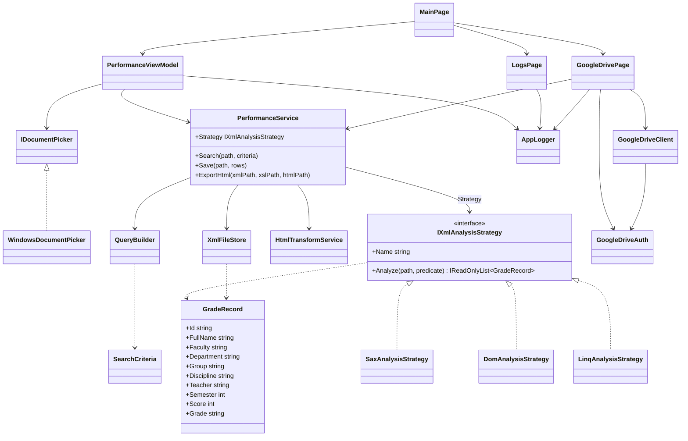

# Student-Performance

**Object-Oriented Programming — Laboratory Work 2, Variant 6: Student Performance.**

A C# / .NET MAUI desktop application for Windows with a dark interface. It searches student performance records in XML and exports the selected records to XML or HTML using an XSL stylesheet.

## Requirements

- Windows 10 version 1809 or later, or Windows 11 (x64).
- .NET 10 SDK with the `maui-windows` workload.
- Windows App SDK Runtime, provided by the MAUI development setup.
- Access to NuGet for the initial package restore, unless the packages are already cached.

Install the workload if needed:

```powershell
dotnet workload install maui-windows
```

Alternatively, install the .NET MAUI development workload through Visual Studio Installer.

## Run

Open `Student-Performance.sln` in Visual Studio with .NET 10 / MAUI support and select the Windows target, or run these commands from the project directory:

```powershell
dotnet restore Student-Performance.csproj
dotnet build Student-Performance.csproj -t:Run
```

The application starts with an empty result list. Click **Відкрити XML** to load your own XML document. An extended fictional dataset is available in `Examples/Student-Performance.xml`; open it manually to explore the application. The HTML stylesheet is embedded in the application.

## Project structure

- `Student-Performance.sln`: the solution to open in Visual Studio.
- `Student-Performance.csproj`: the MAUI project.
- `Examples/Student-Performance.xml`: 45 grade records, 15 students, 8 groups, 3 faculties, 4 departments, 12 disciplines and 12 teachers. Students with any score below 60 have been removed from this sample. All personal data is fictional.
- `src/Core/`: models, query construction, XML strategies and services.
- `src/Platforms/Windows/`: Windows startup, manifest and file dialogs.
- `src/Resources/Student-Performance.xsl`: embedded HTML transformation stylesheet.
- `src/`: XAML interface, dark theme, ViewModel and commands.

## XML format

Use a `performance` root without a namespace and direct `record` children with unique `id` attributes. Each record requires nonempty `FullName`, `Faculty`, `Department`, `Group`, `Discipline`, `Semester` and `Score` elements. One record describes one student's result in one discipline. Scores must be 0–100 and semesters 1–12. The optional `Teacher` element specifies the teacher; older files without it remain supported. Teacher names are included in keyword search, displayed in the results, and preserved in XML and HTML exports.

Known fields must contain plain text or CDATA, without nested elements or XML namespaces. Duplicate fields and IDs are rejected consistently by all three analysis strategies. Unknown extension fields are ignored. A failed query or file load keeps the previous successful result visible.

## Class diagram

The laboratory requires a class diagram and a design pattern. `PerformanceService` is the Strategy context; the three XML implementations share `IXmlAnalysisStrategy`. The UI delegates analysis, query construction, persistence, authentication and cloud operations to dedicated classes.



## Features

- Three interchangeable XML analysis strategies: streaming `XmlReader`, DOM `XmlDocument`, and LINQ to XML `XDocument`.
- The Strategy pattern for switching the XML analysis algorithm.
- Dynamic combinations of keyword, faculty, department, group, discipline, semester and score filters.
- XML export of the current selection.
- XSLT-based HTML export using the embedded XSL stylesheet.
- Direct Google Drive API integration: browser sign-in, XML listing and download, and upload of the current selection as a new file.
- A dark MAUI interface with MVVM, record count and the average score of the current selection.

The streaming implementation is labelled SAX to follow the supplied laboratory materials. Technically, `XmlReader` uses a pull model, while classic SAX uses a push/event model. MAUI is used under the laboratory's allowance to choose an alternative to Windows Forms.

## Verification

The audit on 14 November 2026 passed 319 local checks and 25 mocked HTTP/OAuth checks. Local coverage includes all three parsers, independent expected filter results, combined filters, malformed XML, namespaces, duplicate IDs/fields, CDATA, XML round trips, HTML escaping, grade boundaries, ViewModel commands, cancellation of file dialogs and cloud-cache replacement. HTTP checks cover authorization headers, refresh tokens, pagination, download/upload requests, partial consent, persistent authorization failures and sign-out.

A Windows UI test opened the 45-record sample, filtered four records by teacher, and saved both XML and HTML through the system dialogs. Using the existing authorized Google session, a user-approved `Student-Performance-test.xml` containing those four fictional records was uploaded, listed and downloaded back successfully. No other cloud files were changed. A fresh interactive sign-in with a new Google account was not repeated.

Debug and framework-dependent Release builds passed without warnings or errors. A self-contained Release restore requires runtime packages available from NuGet; offline availability of those packages was not verified.

Keyword filtering no longer concatenates every record's text once per search word. In an isolated CPU-only check with 30,000 in-memory records and five matching words, the median of seven runs was approximately 68 ms before and 44 ms after the change, with about 28 MB of temporary allocations removed per run. These timings depend on the machine and do not represent the total XML load or UI rendering time. Cloud downloads are streamed to disk instead of buffering the complete XML response in memory; serialization for cloud uploads runs off the UI thread.

## Usage

The interface is in Ukrainian.

1. Use **Відкрити XML** to open `Examples/Student-Performance.xml` or your own XML file using the format above.
2. Select an analysis strategy and enter any combination of filters.
3. Click **Знайти** to apply the query. Empty fields do not restrict the results. All active conditions are combined with AND. Text matching ignores case; each keyword must occur in a text field of the record.
4. Use **Скинути фільтри** to display all records again. The filter panel can be scrolled on smaller windows.
5. Use **Зберегти XML** to save the current selection, or **Експорт HTML** to transform it using the supplied stylesheet.

The grade mapping is 3: 60–74, 4: 75–89, 5: 90–100. Scores below 60 are absent from the sample. Imported files may still contain scores from 0–59; these display a dash instead of a grade. The same mapping is used in the application and HTML export. XML retains the original numeric score.

## Event journal

Click **Логи** to view the latest 500 events, filter by **Зміни** (Change), **Перехід** (Navigation), or **Помилка** (Error), refresh the list, or save the displayed selection as text. Newer events appear first.

`src/Logging/AppLogger.cs` implements Singleton using a private constructor and a thread-safe `Lazy<AppLogger>` instance. DI registers that same instance for the ViewModel, cloud page and log viewer. Each event includes its timestamp with UTC offset, level and message. The journal covers initialization, XML opening and search, filter reset, XML/HTML saves, cloud listing/download/upload, navigation and errors.

Events persist at `%LOCALAPPDATA%/Student-Performance/Logs/application.log`, outside the repository. At approximately 2 MB the current file rotates into `application.log.previous`; one previous file is retained. If disk access fails, recent session events remain available in memory and the viewer shows a storage warning. The text export follows the selected level and the 500-event display limit.

Logs contain operation names, counts and exception types. They do not include search text, student data, filenames, OAuth JSON, access/refresh tokens or raw exception messages. This avoids leaking credentials or document contents through error details. Application messages remain Ukrainian; source-code comments are English.

Logger verification on 18 November 2026 passed 13 checks, including persistence, all levels, filtering, parallel writes, rotation, malformed lines and in-memory fallback. The updated MAUI project builds with zero warnings and errors.

## Google Drive


The **Google Drive** button opens a dedicated page. Google Drive for desktop is not required. The integration uses Drive REST API v3 and desktop OAuth with a system browser, PKCE, a random state and a loopback redirect. There are no additional NuGet dependencies.

### One-time Google Cloud setup

1. Open [Google Cloud Console](https://console.cloud.google.com/) and select or create your project.
2. Enable **Google Drive API** in the API Library.
3. Configure **Google Auth Platform**: set the application name and support/contact email. For a personal Google account, use an External audience in Testing and add your own email as a test user.
4. In **Data Access**, add `https://www.googleapis.com/auth/drive.readonly` and `https://www.googleapis.com/auth/drive.file`. The first permission allows reading existing XML files; the second allows creating result files. Reading the whole Drive uses a restricted scope; distributing the application publicly may require Google verification. For this lab, use your configured test account.
5. In **Clients**, create an OAuth client of type **Desktop app**, then download its JSON. Do not choose Web application or Service account.
6. In the application, click **Google Drive → Імпорт OAuth JSON** and choose the downloaded file. It is imported into local secure storage, not the project directory.
7. Click **Увійти / оновити список**, sign in in the system browser and grant both permissions. Return to the application after sign-in.

See Google's [desktop OAuth documentation](https://developers.google.com/identity/protocols/oauth2/native-app), [consent configuration](https://developers.google.com/workspace/guides/configure-oauth-consent), and [Drive permissions](https://developers.google.com/workspace/drive/api/guides/api-specific-auth).

### Reading and saving XML

- Select an XML from the list and click **Відкрити вибраний XML**. Click **Назад** to see the records and use the existing filters and analysis strategies.
- To try the supplied sample, upload `Examples/Student-Performance.xml` through the Google Drive website, then refresh the list in the application.
- To save, first select the records on the main screen, then open Google Drive, enter a filename and click **Створити XML у Google Drive**. Upload uses the current selection, including a file just opened from the cloud page.
- Each upload creates a **new file in the root of My Drive**. Existing files are never overwritten; repeated names can therefore create multiple files. Refresh the list after saving.
- **Скасувати операцію** cancels an in-progress request. Browser sign-in expires after three minutes. Cancellation during upload can leave an already-created file in Drive; refresh the list before retrying.
- **Вийти** clears the locally stored session, while keeping the imported client configuration. It does not sign out of the browser or revoke Google's grant. Access can be revoked in your Google account's connected-app settings. Import another Desktop JSON to replace the configuration.

Client configuration and refresh tokens are stored with MAUI SecureStorage, and access tokens are held in memory. Do not commit OAuth JSON or token files. The default downloaded filenames are excluded by `.gitignore`; keep files with other names outside the repository too. Never paste the JSON contents into the README or source code.

Real account sign-in and cloud operations require your own OAuth client and network access. Automated HTTP checks do not replace this final account test. The integration targets ordinary XML files in My Drive; Google Docs/Sheets conversion and Shared Drive administration are outside this version.
- Persistent event journal with a Singleton logger, Change/Navigation/Error levels, timestamps, filtering and text export through the **Логи** button.
